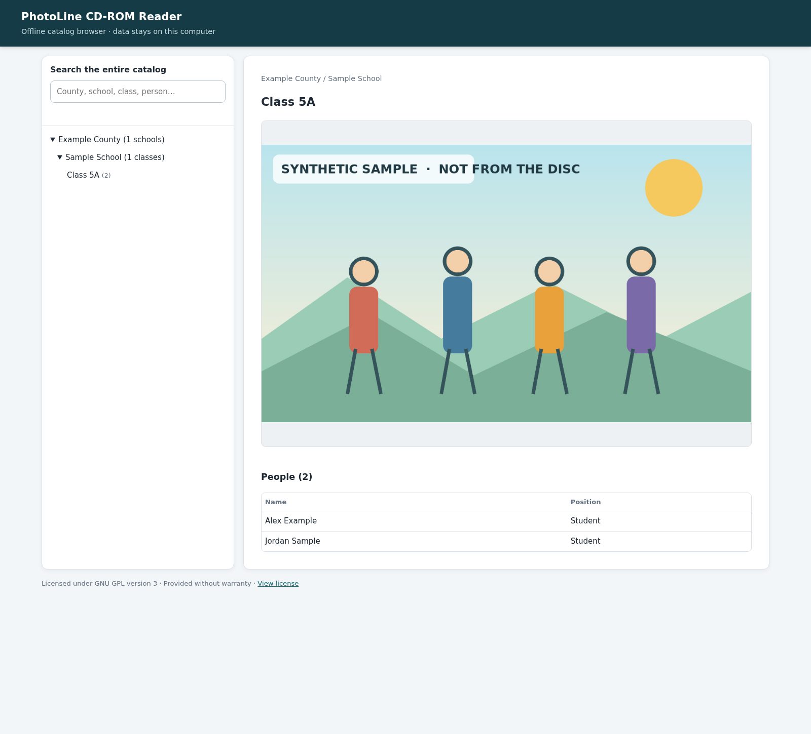

# PhotoLine CD-ROM Reader

A standalone, read-only viewer for a locally held PhotoLine school-photo catalog. The same Go source builds native Linux and Windows executables; the web interface is embedded in each binary and opened in your browser.

> **The catalog is not included.** This repository, its releases, the container image, and the screenshot contain software and synthetic demonstration material only. They do not contain the disc image, catalog database, original executable, or photographs. The screenshot uses invented sample labels and an illustration, not material from the disc. You must supply your own lawful local copy of the catalog. Consider copyright, database rights, and privacy before sharing catalog data or screenshots.



## Features

- Browse county → school → class and view the people list beneath the class picture.
- Search the full catalog; matching is case-insensitive and ignores repeated whitespace. If there is no exact substring match, clearly labelled similar matches allow one character edit or adjacent transposition.
- Read the catalog and pictures locally; no upload, telemetry, or data-folder writes.
- Linux and Windows amd64 binaries, plus a minimal container image published to GHCR.

## Download and run

Download `photoline-cdrom-reader-linux-amd64` or `photoline-cdrom-reader-windows-amd64.exe` and place it beside your `2004/` data directory. The program finds that adjacent folder, starts a loopback-only web server on an available port, and opens the browser. You can instead pass an explicit data path:

```sh
./photoline-cdrom-reader-linux-amd64 -data /path/to/2004
```

PowerShell:

```powershell
./photoline-cdrom-reader-windows-amd64.exe -data 'D:\PhotoLine\2004'
```

To print the local URL without launching a browser, add `-no-browser`. By default the program only accepts loopback listen addresses. Do not enable a non-loopback bind unless you understand and control who can reach it.

## Container (GHCR)

The container image is published only to GitHub Container Registry:
`ghcr.io/davralin/photoline-cdrom-reader:1.0.0`.

Set `PHOTOLINE_DATA_DIR` to the **external** directory containing `TextData.LST` and `Pictures/`, then start the service:

```sh
export PHOTOLINE_DATA_DIR=/absolute/path/to/2004
export PHOTOLINE_UID="$(id -u)"
export PHOTOLINE_GID="$(id -g)"
docker compose up -d
```

Open <http://127.0.0.1:8080/>. Compose mounts the data read-only, makes the container root filesystem read-only, drops Linux capabilities, and publishes the port on host loopback only. To stop it, run `docker compose down`.

The Compose file does not copy or download catalog data. Keep the data outside this software repository.

## Build and test in a container

The release workflow builds and tests using the current Go toolchain in a disposable container. To run the Go tests and vet locally without installing Go on the host:

```sh
docker run --rm -v "$PWD:/src:ro" -w /src golang:1.27.4 \
  sh -ec 'export GOFLAGS=-buildvcs=false; go test ./... && go vet ./... && GOOS=windows GOARCH=amd64 go test -c -o /tmp/reader-tests.exe'
```

Release binaries are produced by the tagged GitHub Actions workflow. The multi-architecture container image is built and pushed to GHCR by that same release workflow.

## Data format and privacy

The parser reads `TextData.LST`, reconstructs the serialized county/school/class/person hierarchy, and associates class-picture references with files in `Pictures/`. The reader currently supports UTF-8 and Windows-1252 strings. The image does not expose source-media files or bundled catalog content.

The native app binds to `127.0.0.1` by default. Container deployment opts into a wildcard container bind, but Compose exposes the service only as `127.0.0.1:8080` on the host. The container runs without write access to the mounted catalog.

## Repository contents

This repository is software-only. It contains the parser, local viewer, tests, release/container configuration, license notices, and a synthetic screenshot. It intentionally excludes the ISO, the extracted catalog, photographs, and built executable artifacts.

## License

The application is distributed under the GNU GPL version 3; see [`LICENSE`](LICENSE). It is provided without warranty. Go runtime and standard-library license terms are reproduced in [`docs/THIRD_PARTY_NOTICES.md`](docs/THIRD_PARTY_NOTICES.md).
